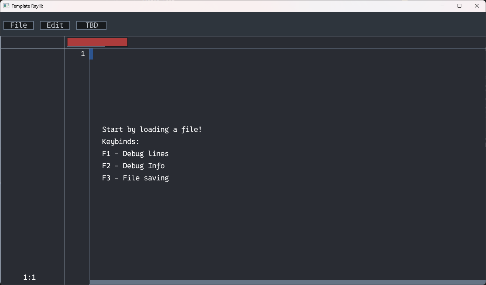
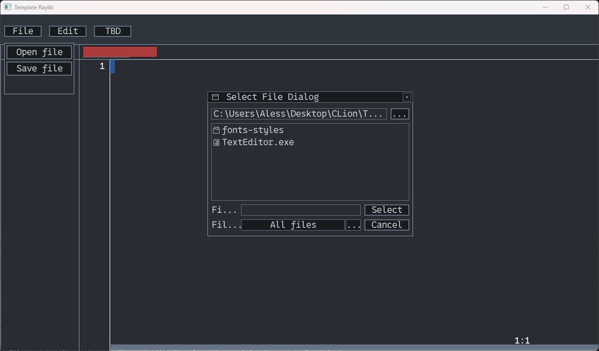
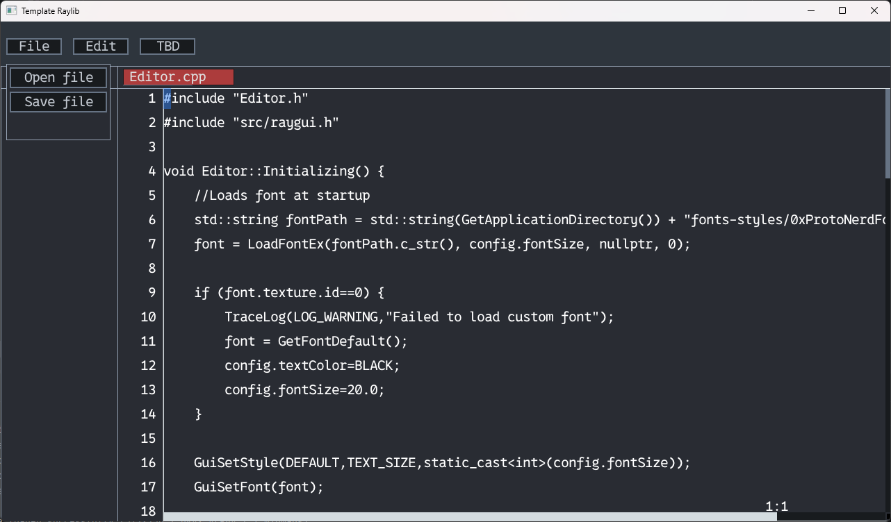

# Monochrome Text Editor

---



## About

Monochrome is a C++ application built using the Raylib and Raygui libraries.
It allows users to load, edit and save files in a simple but effective way!

---
## Why did I create this project?

I merely started programming for about 2 or 3 years, and I've always been amazed by how these big text editors or IDE worked. So I decided to go for it and try to make one!
Of course, it isn't as feature packed as the others.. It merely has basic features like text selection, copy and paste and much else.. But I wanted to give it a try anyway!

Reason for the name of this project? I honestly had no idea how to call it, but then, I saw the name of a famous company that makes
notebooks here in Italy, and it's called "Monochrome" so I decided to go for that.

---
## Features

- File loading
- File saving
- File dialog to load files
- Cursor movement
- Scroll panel
- Rename file
- Custom font

---
## Screenshots





---
## Platforms

>[!WARNING]
> The software is available for Windows and Linux **ONLY**. Trying to compile or run it on other platforms such as MacOS **WILL cause problems or won't start at ALL**!

| Platforms | Availability  |
|----------:|---------------|
|   Windows | Available     |
|     Linux | Available     |
|     macOS | Unavailable   |
## Compiling

### Build Requirements
- C++20 Compiler: 
  - Windows: MinGW-w64 or MSVC
  - Linux: GCC or Clang
- CMake 3.24 or newer
- Git

(Linux also requires some libraries used by raylib!)

**For ubuntu** :
```
sudo apt install libasound2-dev libx11-dev libxrandr-dev libxi-dev libgl1-mesa-dev libglu1-mesa-dev libxcursor-dev libxinerama-dev libwayland-dev libxkbcommon-dev
```

**For fedora**:
```
sudo dnf install alsa-lib-devel mesa-libGL-devel libX11-devel libXrandr-devel libXi-devel libXcursor-devel libXinerama-devel libatomic
```

## Clone the repository
```
git clone https://github.com/fireslash88/MonochromeTextEditor.git
cd MonochromeTextEditor
```

## Create a build directory and generate the build files
**For windows**:
```
cmake -S . -B build-windows -DCMAKE_BUILD_TYPE=Release
```
**For Linux**:
```
cmake -S . -B build-linux -DCMAKE_BUILD_TYPE=Release
```

## Compile the software
**For windows**:
```
cmake --build build-windows --config Release
```
**For Linux**:
```
cmake --build build-linux --parallel
```

## Final setup
**For windows**:
```
cmake --install build-windows --prefix staging-windows --config Release
```
**For Linux**:
```
cmake --install build-linux --prefix staging-linux
```
After doing so, if you go inside the MonochromeTextEditor folder, you'll see a staging folder with inside the files and the executable!

---
## AI Notice

My idea was to create a project to learn things by myself and trying to do it without using AI.

But unfortunately I had to use it in some parts to help me out for some things that I really didn't know how to fix.

## Credits and support!
This project was made using two libraries as a base, the **raylib library** and the **raygui library**!
You should absolutely check them out and also all the other libraries made by raysan8!

I also used as a font the 0xProto font! You should also check it out as it's a really beautiful font in my opinion!

This project was also made for the Stardance challenge, organized by Hack Club!
